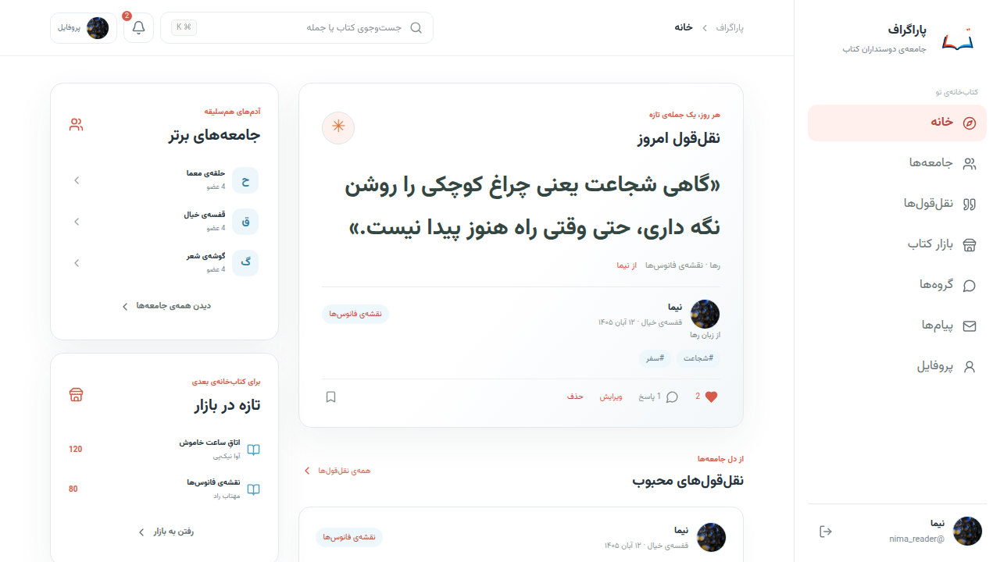
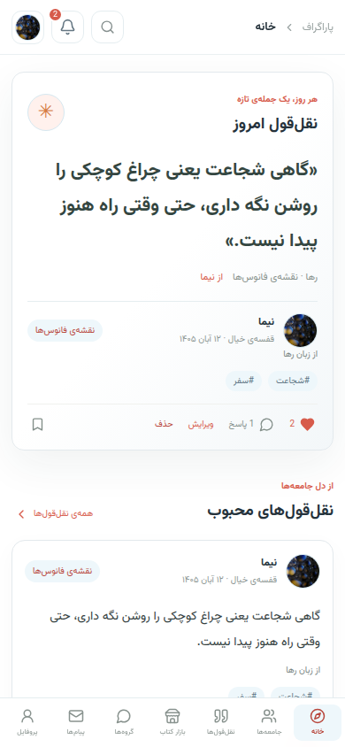

  

# پاراگراف | Paragrapher

Paragrapher is a Persian, home for memorable lines. Readers gather in communities around books and topics, save quotes in a character’s voice, and carry those passages into replies and group conversations. Daily and popular feeds help readers find the next line or book to remember.

The frontend is a React single-page app. Its API lives in a separate Flask repository:

- [Backend repository](https://github.com/nima-kam/pragrapher)
- [Backend setup and API guide](https://github.com/nima-kam/pragrapher/blob/main/README.md)

## Screenshots

The images below show the app running locally with its repeatable Persian demo content.

| Desktop | Mobile |
| --- | --- |
|  |  |

## Features

- Persian RTL reader profiles and public or private book communities.
- Community discovery, a guided community-creation page, membership, likes, categories, and moderator invitations.
- Quote of the day, popular and recent quote feeds, tags, replies, and likes.
- Search across quotes, books, and communities.
- Book listings, temporary reservations, lending requests, and purchases using local book coins with no cash value.
- Reading groups, group messages, direct messages, and notifications.
- Local discount announcements stored in an email outbox; optional SMTP can be configured by the backend operator.

## Quick start

Requirements: Python 3.12, PostgreSQL 16, and Node.js 24 LTS.

1. Follow the [backend quick start](https://github.com/nima-kam/pragrapher#quick-start) to create the PostgreSQL database, install Python packages, apply migrations, and seed demo content.
2. In a second terminal, start the API from the backend's Back-end directory:

       flask --app wsgi:application run --host 127.0.0.1 --port 5000

3. In this repository:

       cd paragrapher
       nvm use 24
       cp .env.example .env
       npm ci
       npm run dev

4. Open [http://127.0.0.1:5173](http://127.0.0.1:5173) and sign in with the local demo reader:

   - Username: nima_reader
   - Password: ParagrapherDemo123!

The demo password and seeded accounts are for local development only. Do not reuse them in a public deployment. The store uses local book coins only; they have no cash value and no payment provider is connected.

## Configuration

Copy paragrapher/.env.example to paragrapher/.env. Set VITE_API_BASE_URL if the backend is not available at http://127.0.0.1:5000/api/v1. Vite exposes only variables prefixed with VITE_ to browser code; never put secrets there.

## Development

From paragrapher/:

    npm ci
    npm run dev
    npm test
    npm run build

Run browser flows after starting the backend and seeding the local database:

    npx playwright install chromium
    npm run test:e2e

The end-to-end suite writes current desktop and mobile screenshots to paragrapher/public/screenshots/.

## Architecture

The frontend calls the separately versioned Flask API at /api/v1. Browser requests include credentials for the HttpOnly session cookie; state-changing requests fetch and send the session's CSRF token. The API origin is configured with VITE_API_BASE_URL.

The UI is a React 19 application built with Vite. Components and styles retain the Persian RTL presentation; responsive navigation exposes the same feature areas on narrow screens. The API owns persisted state, validation, and authorization. The browser does not keep likes or community membership as local-only state.

See the [backend architecture notes](https://github.com/nima-kam/pragrapher/blob/main/docs/architecture.md) for the API and data model.

## Contributing

Issues and pull requests are welcome. Before submitting a change, include the feature or API behavior affected, migration notes where the data model changes, and the commands used to validate the change. Keep secrets in local environment files, preserve the Persian RTL experience, and update screenshots when the visible home experience changes. See the backend's [contribution guide](https://github.com/nima-kam/pragrapher/blob/main/docs/contributing.md) for cross-repository changes.

## License

This project is distributed under the MIT License. See [LICENSE](LICENSE).
